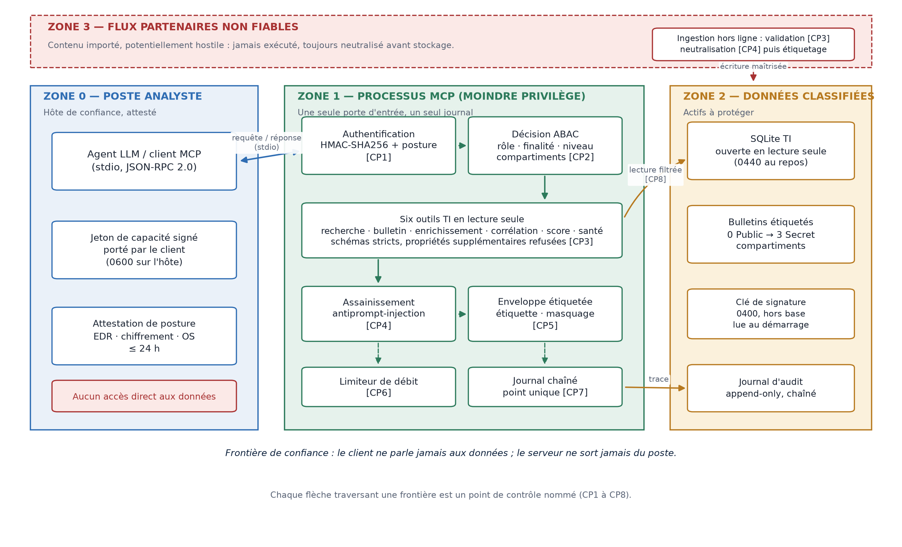
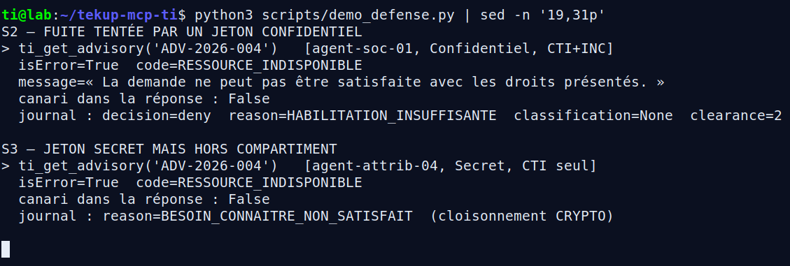
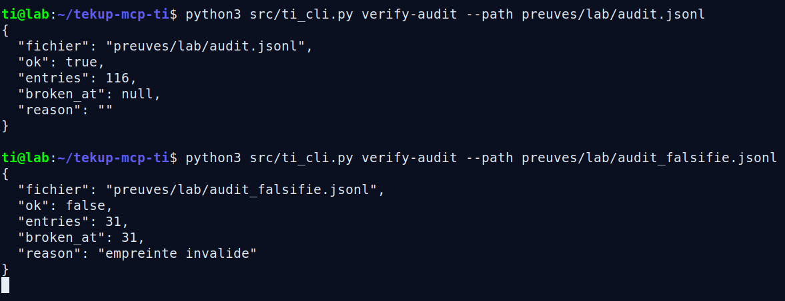
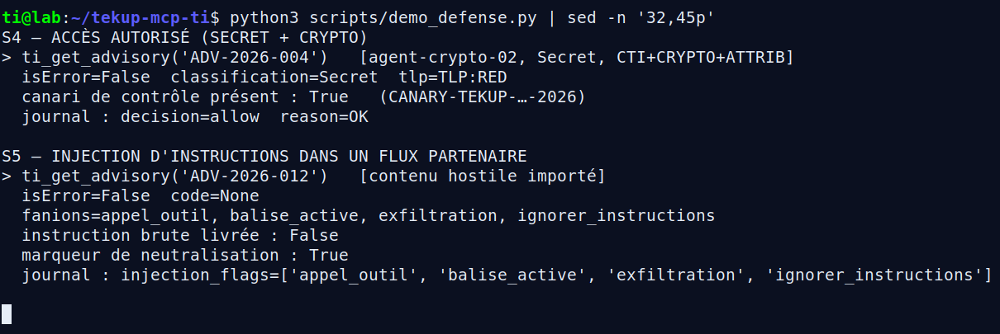
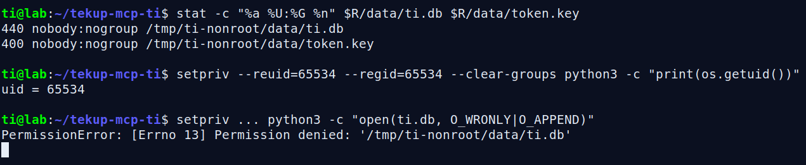

<div align="center">

# MCP Threat Intelligence

**Le plan de contrôle d'un agent de renseignement sur les menaces.**

Six outils MCP en lecture seule, derrière une authentification par capacité, une politique ABAC,
un masquage par classification et un journal d'audit chaîné. Python standard library uniquement.

[](https://www.python.org/)
[](https://modelcontextprotocol.io/)
[]()
[]()
[]()

*Projet académique TEK-UP — SSIR 2026-2027 · Mzabi Sirine · Khaled Ellif · encadrant : Tarek Hdji*

</div>

---

## Le problème

Un agent LLM branché sur un serveur MCP hérite des accès de la machine. Sans plan de contrôle,
une seule instruction injectée dans un bulletin suffit à faire fuiter une source classifiée,
à contourner le cloisonnement ou à sortir des données du périmètre.

Ce projet construit ce plan de contrôle. Chaque requête MCP est **authentifiée, autorisée, filtrée
et tracée** avant d'atteindre les données — et le refus est aussi important que la réponse.

## Ce que le serveur expose

Serveur MCP en `stdio` (JSON-RPC 2.0, protocole `2025-06-18`), 6 outils en lecture seule
et 9 ressources `ti://advisory/...`.

| Outil | Rôle |
| --- | --- |
| `ti_search` | Recherche plein texte dans les bulletins autorisés par le jeton |
| `ti_get_advisory` | Bulletin complet, sous réserve d'habilitation, de cloisonnement et de posture |
| `ti_enrich_ioc` | Enrichissement local d'un indicateur, sans aucun appel réseau |
| `ti_correlate` | Regroupement des indicateurs accessibles par famille et par étiquette |
| `ti_score_asset` | Score de risque composite, explicable et déterministe |
| `ti_health` | Version, durcissement et volumes accessibles, sans donnée de renseignement |

## Sécurité : sept contrôles, pas une promesse

| Contrôle | Implémentation |
| --- | --- |
| **Jeton de capacité signé** | HMAC-SHA256 sur JSON canonique (`ti1.<charge>.<signature>`), comparaison en temps constant, expiration et émission future refusées — [`auth.py`](src/ti_server/auth.py) |
| **Révocation immédiate** | Table SQLite consultée à chaque requête, avant toute lecture — [`store.py`](src/ti_server/store.py) |
| **Posture du poste** | EDR, chiffrement de disque, OS supporté, attestation de moins de 24 h — [`policy.py:44`](src/ti_server/policy.py#L44) |
| **ABAC** | Rôle, habilitation 0–3, compartiments et finalité, outil par outil — [`policy.py:87`](src/ti_server/policy.py#L87) |
| **Classification et masquage** | Treillis TLP/habilitation, canaris de fuite, champs sensibles masqués et signalés — [`labels.py`](src/ti_server/labels.py) |
| **Anti-injection** | Neutralisation des instructions hostiles dans les bulletins, sans altérer le texte légitime — [`sanitize.py`](src/ti_server/sanitize.py) |
| **Audit chaîné** | Journal append-only `seq / prev_hash / entry_hash`, `flock` + `fsync`, écriture refusée si la chaîne est cassée — [`audit.py`](src/ti_server/audit.py) |

Le poste d'exécution est durci : serveur lancé en `uid 65534`, base en `0440`, clé HMAC en `0400`,
limitation de débit à 120 requêtes par minute. Une analyse statique vérifie l'absence de tout
client réseau dans le code serveur.

## Architecture



L'agent ne parle jamais directement à la base : il présente un jeton, la politique rend une décision,
la couche de données ne rend que ce que la décision autorise, et chaque étape laisse une trace
vérifiable. Les données sont **100 % synthétiques** : 12 bulletins, 30 indicateurs, 6 actifs.

## Résultats mesurés

| Mesure | Valeur |
| --- | --- |
| Scénarios nominaux et durcissement | 15 / 15 |
| Scénarios d'abus | 16 / 16 détectés |
| Chaîne d'audit | 116 entrées, 115 liens valides |
| Latence (60 appels, ext4) | p50 5,57 ms · p95 6,48 ms |
| Poste Windows/WSL (DrvFs) | p95 45,95 ms |
| Injection d'instructions | 3 / 3 neutralisées, 0 faux positif sur 11 bulletins bénins |
| Révocation | jeton refusé à la requête suivante |

Chaque campagne écrit un journal horodaté, archivé avec les autres preuves d'exécution.

## Captures d'écran

| Fuites bloquées | Audit falsifié |
| --- | --- |
|  |  |
| **Accès et injection** | **Moindre privilège** |
|  |  |

Les sept captures réelles sont dans [`preuves/captures_ecran/`](preuves/captures_ecran/).

## Démarrage rapide

Prérequis : Linux ou WSL2, Python 3.11+ (testé avec 3.14.4), aucune dépendance à installer.

```bash
git clone https://github.com/Mzabi-Sirine/mcp-threat-intelligence.git
cd mcp-threat-intelligence

python3 tests/run_tests.py          # campagne complète : 31/31 attendu
python3 tests/test_audit_tail_utf8.py   # régression UTF-8 du journal
bash demo/lancer_demo.sh            # démonstration interactive, 7 scènes
python3 src/ti_cli.py verify-audit --path preuves/lab/audit.jsonl
```

Brancher le serveur dans un client MCP :

```json
{
  "mcpServers": {
    "threat-intelligence": {
      "command": "python3",
      "args": ["-m", "ti_server"],
      "env": {
        "PYTHONPATH": "src",
        "TI_MCP_TOKEN": "ti1.<charge>.<signature>"
      }
    }
  }
}
```

Les jetons de démonstration se génèrent avec `python3 src/ti_cli.py demo-tokens`.

## Structure du dépôt

```
src/ti_server/     serveur MCP, politique ABAC, audit, assainissement
src/ti_cli.py      console : jetons, révocation, vérification d'audit
tests/             31 scénarios + régression UTF-8
scripts/           démonstration, captures, génération des figures
demo/              lanceurs de soutenance
data/              jeu synthétique (bulletins, indicateurs, actifs, base)
preuves/           captures d'écran et campagnes filmées
figures/           schémas du rapport
docs/              sources de génération du rapport, du deck et des fiches
livrables/         rapport, deck, note de synthèse et conducteur (PDF)
```

## Livrables

| Document | Fichier |
| --- | --- |
| Rapport final (35 pages) | [`livrables/Rapport_MCP_Threat_Intelligence_TEK-UP.pdf`](livrables/Rapport_MCP_Threat_Intelligence_TEK-UP.pdf) |
| Deck de soutenance (16 diapos) | [`livrables/Deck_Soutenance_MCP_TI.pdf`](livrables/Deck_Soutenance_MCP_TI.pdf) |
| Deck avec notes orales imprimables | [`docs/deck/Deck_Soutenance_MCP_TI_notes.pdf`](docs/deck/Deck_Soutenance_MCP_TI_notes.pdf) |
| Note de synthèse (4 pages) | [`livrables/Note_de_synthese_MCP_TI.pdf`](livrables/Note_de_synthese_MCP_TI.pdf) |
| Conducteur de soutenance | [`livrables/Conducteur_soutenance_MCP_TI.pdf`](livrables/Conducteur_soutenance_MCP_TI.pdf) |
| Campagne de tests filmée (34 s) | [`preuves/video/Demo_Tests_MCP_TI.mp4`](preuves/video/Demo_Tests_MCP_TI.mp4) |
| Démonstration filmée (1 min 55) | [`preuves/video/Demo_MCP_Threat_Intelligence_voix.mp4`](preuves/video/Demo_MCP_Threat_Intelligence_voix.mp4) |

## Statuts

« Testé » : une commande a produit une preuve conservée. « Configuré » : mécanisme en place,
intégration réelle à faire. « Proposé » : décrit sans exécution. Aucun élément non testé n'est
présenté comme fonctionnel.

## Limites assumées

- Jeu de données synthétique, aucune donnée réelle, aucune attaque hors du laboratoire.
- Détection d'injection heuristique : un corpus plus large est nécessaire avant production.
- Chaîne d'audit locale : une réécriture complète par un attaquant disposant des droits d'écriture
  n'est pas exclue sans ancrage externe.
- Authentification par jeton en variable d'environnement, adaptée au laboratoire ; une fédération
  OAuth/mTLS est proposée pour la production.

---

<div align="center">

**Mzabi Sirine · Khaled Ellif** — TEK-UP, SSIR 2026-2027 · encadrant Tarek Hdji

</div>
